# SeismicPi

**Sismografo casalingo per Raspberry Pi con accelerometro MPU-6050.**

Permette di:

- rilevare le vibrazioni e catalogare gli eventi;
- consultare un rullo digitale come quello dei sismografi a carta;
- confrontare gli eventi con i cataloghi ufficiali INGV, EMSC e USGS;
- ricevere allerte su Telegram;
- gestire tutto da una dashboard web completa, anche senza Internet.

[](LICENSE)


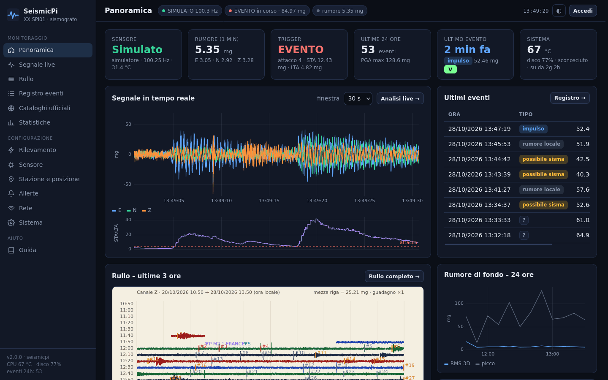

> Pensato per girare su un **Raspberry Pi Zero** da 512 MB: niente numpy, niente framework
> JavaScript, niente CDN. Il Pi acquisisce, rileva e archivia; grafici, spettri e filtri di
> visualizzazione li calcola il browser.

*English summary at the [end of this page](#english-summary).*

---

## Indice

- [Caratteristiche](#caratteristiche)
- [Galleria](#galleria)
- [Hardware](#hardware)
- [Installazione](#installazione)
- [Primi passi dopo l'installazione](#primi-passi-dopo-linstallazione)
- [La dashboard, pagina per pagina](#la-dashboard-pagina-per-pagina)
- [Come funziona il rilevamento](#come-funziona-il-rilevamento)
- [Allerte e integrazioni](#allerte-e-integrazioni)
- [Rete e Access Point di emergenza](#rete-e-access-point-di-emergenza)
- [Protezione della scheda SD](#protezione-della-scheda-sd)
- [Architettura](#architettura)
- [API](#api)
- [Sicurezza](#sicurezza)
- [Sviluppo e prove senza hardware](#sviluppo-e-prove-senza-hardware)
- [Limiti del sensore](#limiti-del-sensore)
- [Risoluzione dei problemi](#risoluzione-dei-problemi)
- [Licenza e crediti](#licenza-e-crediti)

---

## Caratteristiche

### Acquisizione
- Lettura dell'**MPU-6050** via I2C dalla **FIFO hardware**. Il chip accumula fino a 1,7 s di
  campioni, quindi il software regge anche brevi blocchi del sistema senza perdere dati.
- Campionamento a **50, 100 o 200 Hz**, fondo scala ±2…±16 g e filtro anti-alias interno
  configurabili.
- **Orologio dei campioni:** la frequenza reale dell'oscillatore del chip viene stimata sul lungo
  periodo (scarto tipico ±1-2%) e la fase viene agganciata all'ora di sistema, sincronizzata
  via NTP.
- **Orientamento automatico** degli assi (quale asse è verticale) e **calibrazione** degli
  offset con il sensore in bolla.
- **Autotest di fabbrica** dell'accelerometro (procedura del datasheet) e **scansione del bus
  I2C** dalla dashboard.
- Rilevamento di **buchi**, **overflow della FIFO** ed **errori I2C**, con riconnessione
  automatica del sensore.
- **Sensore simulato** realistico per sviluppo e dimostrazioni: rumore del MEMS, attività
  domestica giorno/notte, urti, passi e terremoti sintetici con fasi P e S e coda.

### Rilevamento e analisi degli eventi
- Trigger **STA/LTA** ricorsivo su un canale a scelta (modulo 3D, verticale, orizzontale, asse
  singolo, qualsiasi asse), con LTA congelato durante l'evento.
- **Trigger ad accelerazione assoluta** per le scosse forti con inizio graduale.
- Registrazione di **pre-evento e post-evento**: retrigger nello stesso evento, durata minima e
  massima, pausa dopo l'evento.
- Parametri calcolati in tempo reale, campione per campione:
  - **PGA** per asse e del modulo 3D;
  - **PGV** per integrazione;
  - **intensità di Arias** e **CAV**;
  - **frequenza dominante**;
  - **rapporto H/V**;
  - picco STA/LTA.
- **Intensità macrosismica** stimata (scala MMI/MCS) con le relazioni di Worden et al. (2012).
- **Classificazione automatica** in impulso locale, rumore locale o possibile sisma, con indice
  di affidabilità e motivazione.
- **Conferma dai cataloghi ufficiali:** per ogni terremoto INGV/EMSC/USGS si calcolano
  distanza, azimut e tempi d'arrivo teorici P/S alla stazione. Se un trigger cade nella finestra
  giusta e il terremoto era plausibilmente percepibile, l'evento diventa **"sisma confermato"**.

### Archivio
- **Forme d'onda di ogni evento** conservate senza scadenza, con export **miniSEED** (leggibile
  da ObsPy, SeisComP, Swarm), **CSV**, **JSON** e **PNG**.
- **Dati grezzi continui** in RAM (ultime N ore), su SD (N giorni) oppure disattivati.
- **Rullo (helicorder):** inviluppi min/max a 2 Hz per 4 canali (E, N, Z, modulo), 2,8 MB al
  giorno, conservati per mesi.
- **Statistiche al minuto:** rumore RMS per asse, picchi, componente statica (inclinazione),
  temperatura, frequenza effettiva, qualità dei dati.
- **Telemetria del Raspberry:** CPU, temperatura, frequenza, RAM, disco, byte scritti sulla
  SD, traffico Wi-Fi, sottotensione.
- Pulizia automatica secondo i periodi di conservazione e una **soglia di spazio libero
  minimo**.

### Dashboard web
- **Panoramica:** stato, segnale in tempo reale, STA/LTA, ultimi eventi, rullo delle ultime ore,
  rumore delle 24 ore, terremoti vicini.
- **Segnale live:**
  - tre assi più il modulo, con finestra e filtri regolabili;
  - spettro di ampiezza e spettrogramma;
  - moto della particella e valori di picco e RMS.
- **Rullo digitale:**
  - righe da 5 a 60 minuti e durata da 3 a 24 ore;
  - stile carta o scuro e guadagno regolabile;
  - eventi locali e arrivi P/S dei cataloghi segnati sul tamburo;
  - clic su un punto per aprire il sismogramma;
  - esportazione in PNG.
- **Registro eventi:** filtri per periodo, classe, etichetta, PGA, MMI, preferiti e conferma;
  ordinamento, paginazione, azioni di gruppo, export CSV.
- **Dettaglio evento:**
  - parametri completi e intensità;
  - annotazioni (etichetta, note, classe, preferito) e associazione manuale al catalogo;
  - sismogrammi con zoom sincronizzato;
  - filtri a fase zero e accelerazione o velocità;
  - STA/LTA ricalcolato, spettro, spettrogramma, moto della particella;
  - lettura delle fasi P e S con stima della distanza;
  - mappa dell'epicentro e scorrimento all'evento precedente o successivo.
- **Cataloghi ufficiali:** mappa, tabella e grafico magnitudo-distanza dei terremoti rilevati e
  non rilevati.
- **Statistiche:**
  - eventi per giorno, ora e classe, istogramma e curva cumulativa della PGA;
  - mappa del rumore giorno × ora;
  - inclinazione e deriva termica;
  - telemetria di sistema e occupazione dell'archivio.
- **Configurazione completa** da interfaccia: rilevamento (con preimpostazioni), sensore,
  stazione con mappa, allerte, rete, archiviazione, accesso.
- **Sistema:**
  - hardware (tensioni, clock VideoCore, throttling, scheda SD, USB, processi);
  - servizi e journal;
  - sessioni, backup e ripristino;
  - riavvio e spegnimento;
  - impostazione dell'ora dal browser.
- Tema chiaro e scuro, unità a scelta (mg, cm/s², m/s²), orari locali o UTC, layout adatto al
  telefono, **guida integrata**.

### Allerte
- **Bot Telegram:**
  - messaggi con sismogramma allegato e allerta immediata **"scossa in corso"** per le scosse
    forti;
  - riepilogo giornaliero;
  - **comandi** (`/stato`, `/grafico`, `/ultimi`, `/evento`, `/rumore`, `/oggi`, `/catalogo`,
    `/registra`, `/silenzia`, `/riattiva`, `/ip`);
  - allerte di sistema.
- Regole: classi, intensità e PGA minime, limite orario, ore di silenzio (scavalcabili dalle
  scosse forti), sospensione temporanea.
- **Webhook** JSON firmato HMAC-SHA256, **MQTT** con autoconfigurazione di **Home Assistant**,
  **uscita GPIO** per cicalino, LED o relè.
- Coda persistente: senza Internet le notifiche aspettano e partono appena possibile.

### Rete e sistema
- **Access Point di emergenza:** se il Pi non trova reti note crea il proprio Wi-Fi da cui
  configurarlo, e riprova periodicamente le reti conosciute.
- Gestione delle reti Wi-Fi dalla dashboard: scansione, aggiunta, priorità, eliminazione.
- **Protezione della SD:** scritture ridotte di oltre il 90% rispetto a un archivio continuo su
  SD.
- Installazione con un solo comando, idempotente, con servizi systemd e permessi minimi
  (polkit).

---

## Galleria

Gli screenshot mostrano dati del **sensore simulato** e terremoti reali dei cataloghi INGV/EMSC.

| | |
|---|---|
| 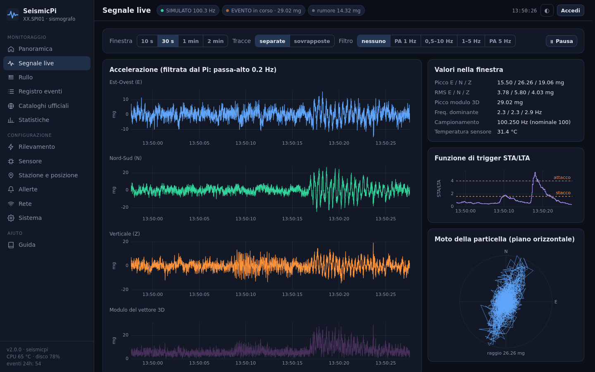 **Segnale live**: tre componenti, modulo, STA/LTA, valori e moto della particella | 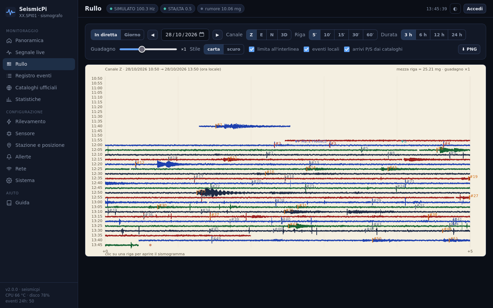 **Rullo digitale** in stile carta con eventi locali e arrivi P/S dei cataloghi |
| 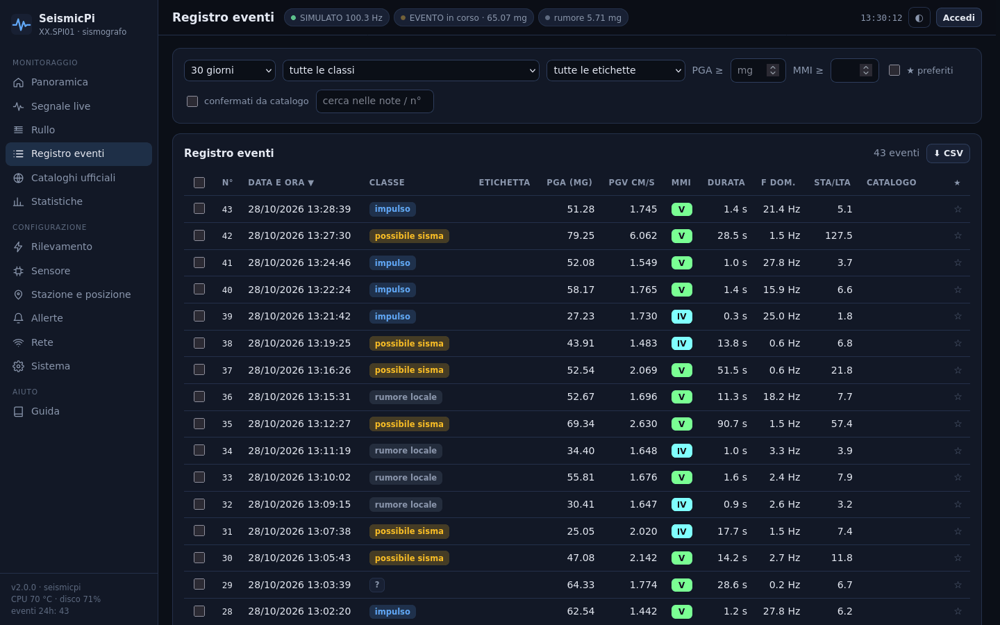 **Registro eventi** con filtri, classi, intensità e associazioni ai cataloghi | 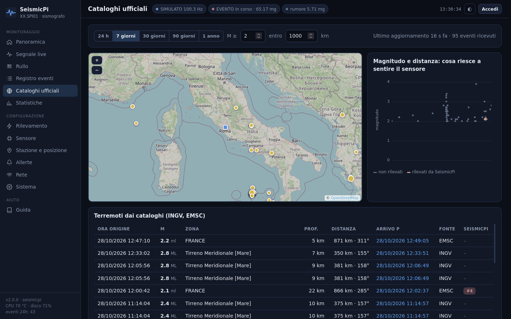 **Cataloghi ufficiali**: mappa, tabella e grafico magnitudo-distanza |
| 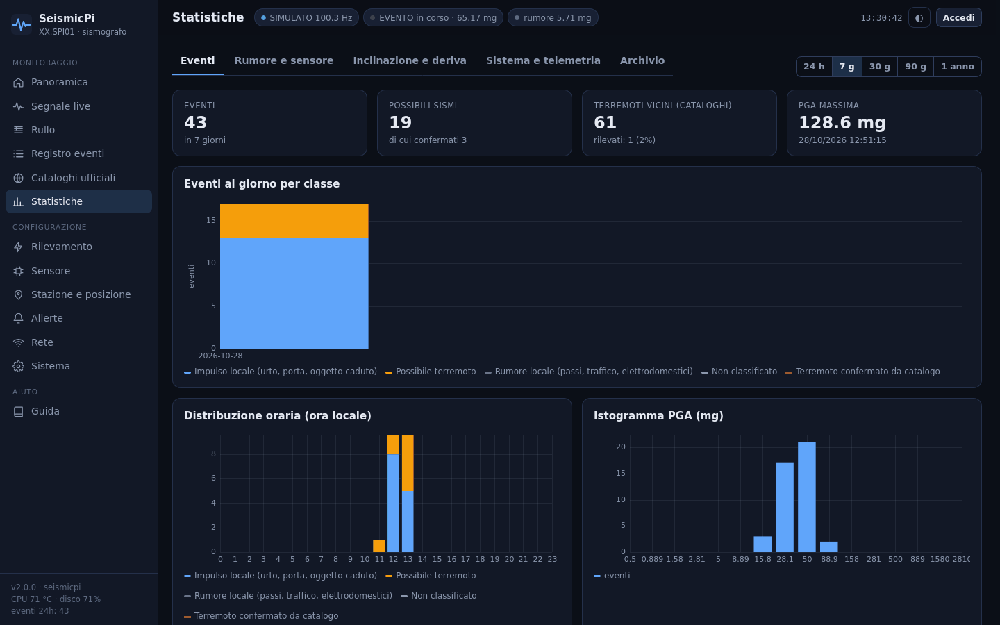 **Statistiche** degli eventi per giorno, ora e classe | 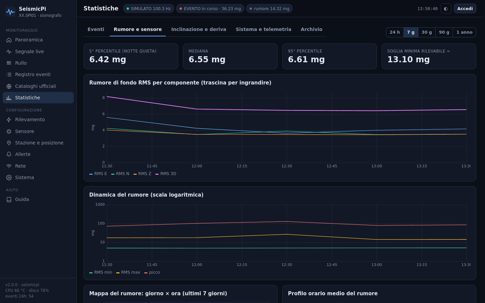 **Rumore di fondo** per componente e nel tempo |
| 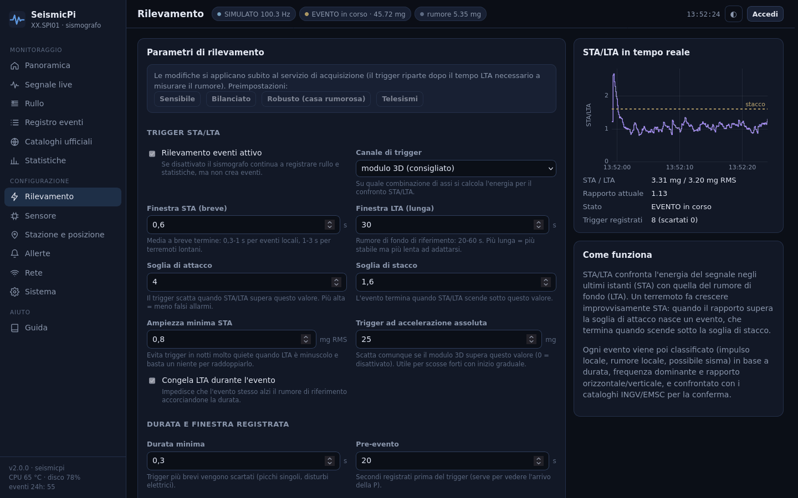 **Rilevamento**: parametri STA/LTA, filtri e preimpostazioni | 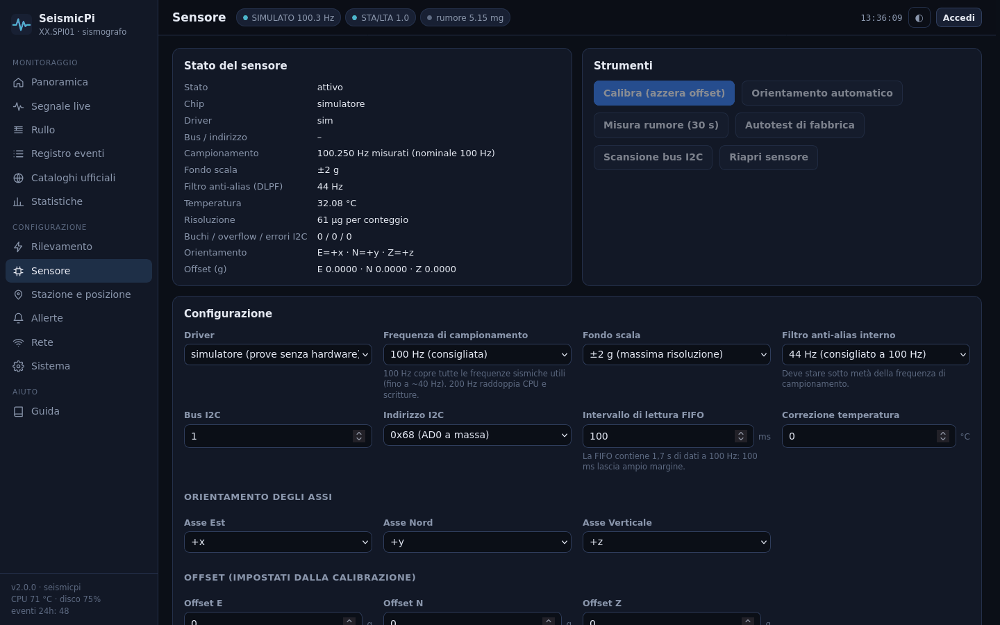 **Sensore**: calibrazione, orientamento, autotest, I2C |
| 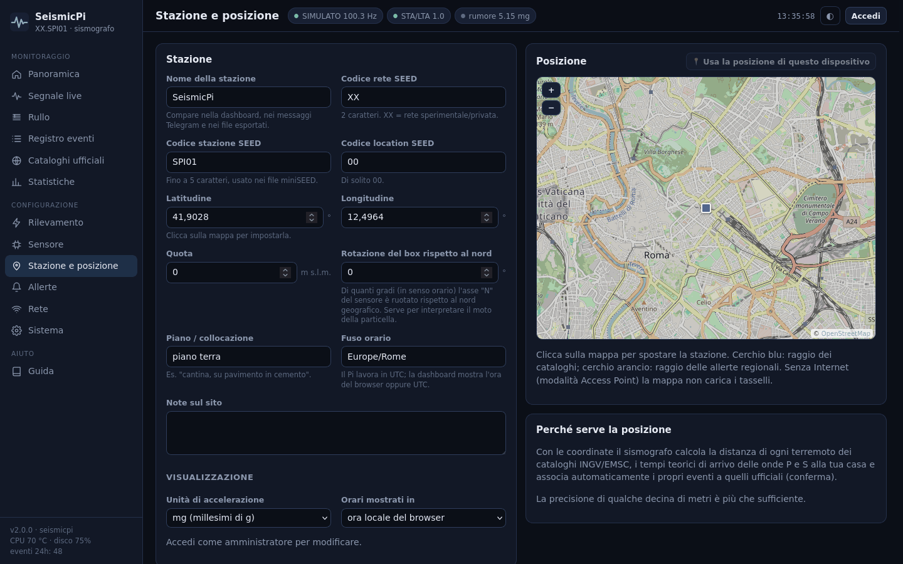 **Stazione e posizione** su mappa | 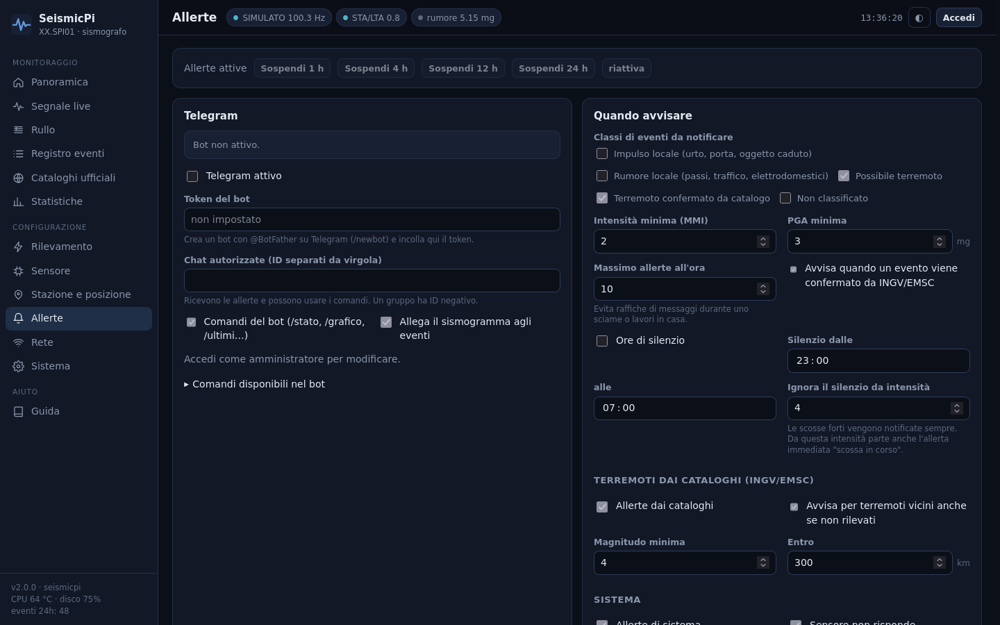 **Allerte**: Telegram, regole, webhook, MQTT, GPIO |
| 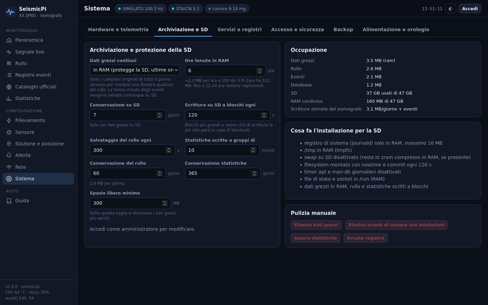 **Archiviazione e protezione della SD** | 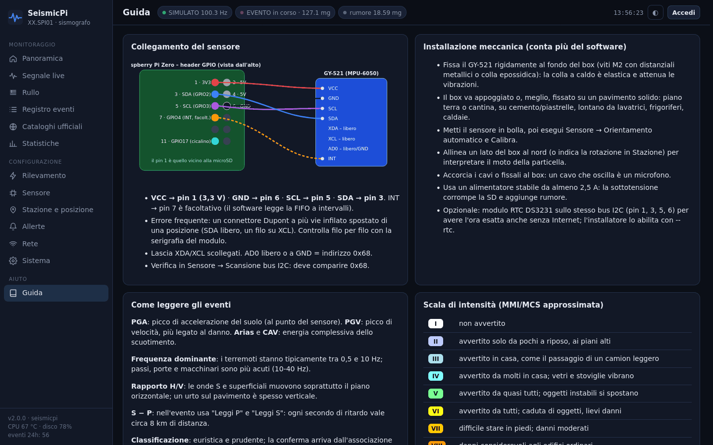 **Guida integrata** con schema di collegamento |

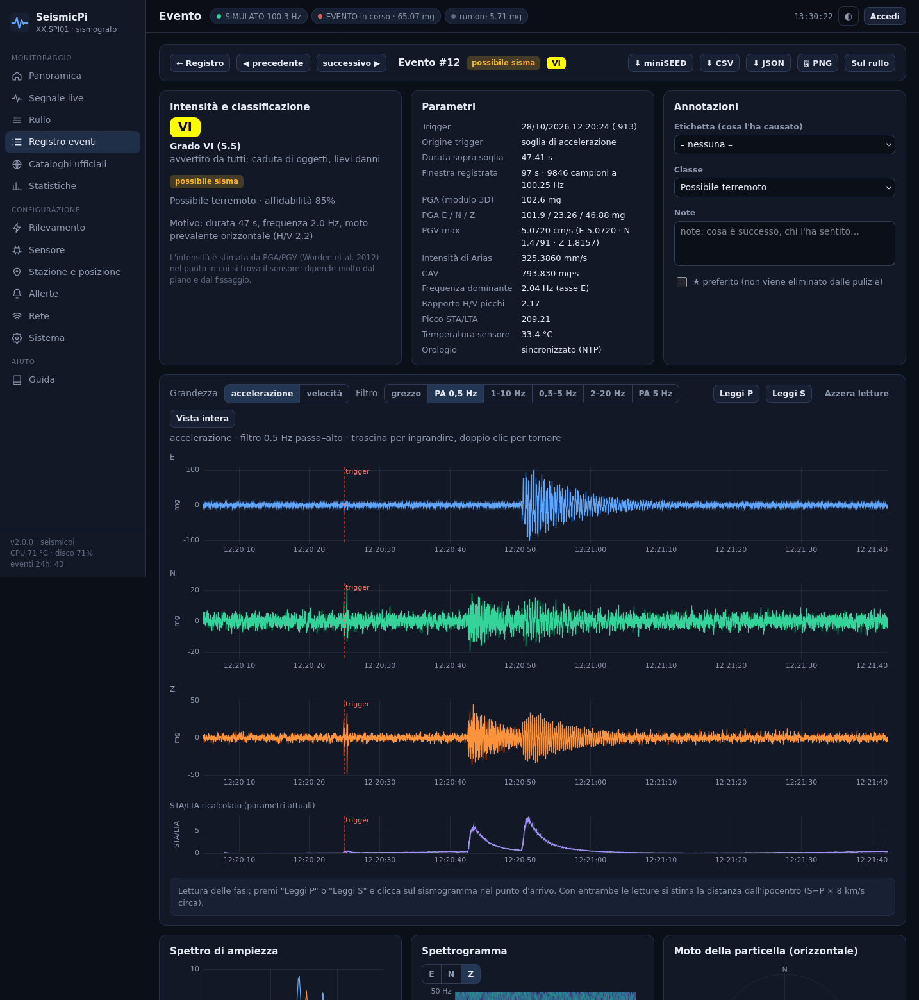
*Dettaglio di un evento: intensità, classificazione, parametri, annotazioni e sismogrammi
filtrati con il trigger segnato.*

---

## Hardware

| Componente | Note |
|---|---|
| Raspberry Pi con header a 40 pin | Zero, Zero W, Zero 2 W, 3, 4, 5. Lo Zero (v1.3) è il più lento ma basta |
| Accelerometro **MPU-6050** (modulo **GY-521**) | I2C. Sono riconosciuti anche cloni e varianti (MPU-6500/9250) |
| Wi-Fi | integrato (Zero W e successivi) oppure chiavetta USB. Per l'Access Point il driver deve supportare la modalità AP |
| Alimentatore 5 V stabile, almeno 2,5 A | la sottotensione corrompe la SD e aggiunge rumore |
| microSD da 8 GB in su | meglio se di tipo "endurance" |
| *Facoltativo:* RTC **DS3231** | ora esatta anche senza Internet (stesso bus I2C, `install.sh --rtc`) |
| *Facoltativo:* cicalino o LED | uscita GPIO per le allerte forti (default GPIO17, pin 11) |

**Collegamento:**

| GY-521 | Pin del Raspberry |
|---|---|
| VCC | **1** (3,3 V) |
| GND | **6** |
| SCL | **5** (GPIO3) |
| SDA | **3** (GPIO2) |
| INT | 7 (GPIO4), facoltativo |

XDA e XCL restano scollegati; AD0 libero o a GND (indirizzo 0x68).

Schema, montaggio meccanico e consigli sono in **[docs/HARDWARE.md](docs/HARDWARE.md)**. Il
montaggio conta più del software: sensore fissato rigidamente, box su un pavimento solido,
lontano dagli elettrodomestici.

<details>
<summary>Il prototipo da cui è nato il progetto (Pi Zero + GY-521 con cavi Dupont)</summary>

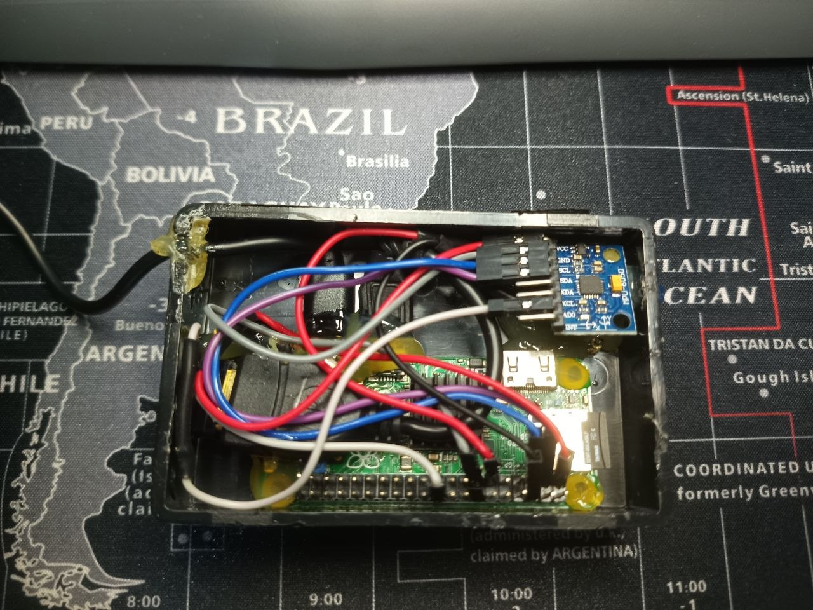
</details>

---

## Installazione

Serve **Raspberry Pi OS Lite** (Bookworm o Trixie). Sui modelli Zero e 1 usa la versione a
**32 bit**: i processori ARMv6 non supportano quella a 64 bit.

1. **Scrivi la SD** con [Raspberry Pi Imager](https://www.raspberrypi.com/software/). Nella
   personalizzazione imposta nome host (es. `seismicpi`), utente e password, la tua rete Wi-Fi e
   SSH attivo.
2. **Collega il sensore** come sopra e accendi il Pi.
3. **Copia il progetto e installa.** Clona il repository sul Pi:

   ```bash
   git clone https://github.com/Indr1d-C0ld/melchior-seismicpi.git seismicpi
   ```

   Oppure copialo dal PC:

   ```bash
   rsync -a ./ <utente>@seismicpi.local:seismicpi/
   ```

   Poi lancia l'installazione:

   ```bash
   cd seismicpi && sudo ./install.sh
   ```

4. **Riavvia** il Pi (`sudo reboot`): attiva l'I2C e le protezioni della SD.

L'installatore:

1. installa i pacchetti Debian necessari (`python3-aiohttp`, `python3-smbus2`, `i2c-tools`,
   NetworkManager, …);
2. abilita l'I2C a 400 kHz;
3. crea l'utente di servizio `seismic`, il codice in `/opt/seismicpi` e i dati in
   `/var/lib/seismicpi`;
4. installa i permessi polkit e i servizi systemd;
5. applica le protezioni della SD;
6. chiede **utente e password della dashboard** (salvata solo come hash);
7. genera una **password casuale per l'Access Point** di emergenza e la mostra alla fine:
   annotala.

| Opzione | Effetto |
|---|---|
| `--user NOME` | nome dell'amministratore della dashboard (default `admin`) |
| `--ap-password PW` | password dell'Access Point invece di quella casuale |
| `--hostname NOME` | imposta il nome host |
| `--country IT` | paese per le regole radio Wi-Fi |
| `--rtc` | abilita un modulo RTC DS3231 |
| `--sim` | prima configurazione con il sensore simulato (demo senza hardware) |
| `--no-sd-protect` | non applica le protezioni della SD |
| `--no-password` | non chiede la password (si imposterà al primo accesso) |
| `--dest DIR` | cartella del programma (default `/opt/seismicpi`) |

Per un'installazione senza domande:
`SEISMICPI_ADMIN_PASSWORD=... sudo -E ./install.sh`.

Per **aggiornare** rilancia `install.sh`: codice e servizi vengono aggiornati, dati e
configurazione restano.

La dashboard è su **`http://seismicpi.local`** oppure sull'indirizzo IP del Pi.

---

## Primi passi dopo l'installazione

1. **Accedi** alla dashboard con l'utente e la password scelti.
2. **Sensore → Scansione bus I2C:** deve comparire `0x68`.
3. **Sensore → Orientamento automatico**, poi **Calibra** (box fermo e in bolla).
4. **Stazione e posizione:** clicca sulla mappa dove si trova il sensore e indica piano e
   collocazione. Servono per distanze, arrivi teorici e conferme dai cataloghi.
5. **Allerte → Telegram** (facoltativo):
   1. su Telegram scrivi a **@BotFather**, comando `/newbot`, e copia il **token**;
   2. incollalo nella dashboard, attiva Telegram e salva;
   3. apri il tuo bot su Telegram e premi **Avvia** (`/start`);
   4. in dashboard premi **Verifica token e chat** e poi **Autorizza** accanto alla tua chat;
   5. premi **Invia prova**.
6. **Rete:** aggiungi eventuali altre reti Wi-Fi e controlla che l'adattatore supporti la
   modalità Access Point.
7. Lascia lavorare il sismografo qualche giorno e **etichetta gli eventi** (passi, porta,
   traffico…). Poi regola il trigger in **Rilevamento**, aiutandoti con il livello di rumore in
   **Statistiche**.

---

## La dashboard, pagina per pagina

| Pagina | Cosa contiene |
|---|---|
| **Panoramica** | stato di sensore, rumore, trigger, eventi delle 24 ore, ultimo evento e sistema; segnale in tempo reale con STA/LTA; ultimi eventi; rullo delle ultime 3 ore; rumore delle 24 ore; terremoti vicini dai cataloghi |
| **Segnale live** | 3 componenti separate o sovrapposte più il modulo 3D; finestra da 10 s a 2 min; filtri passa-alto e passa-banda; spettro (Welch) e spettrogramma per componente; moto della particella; picchi, RMS e frequenze dominanti; pausa; registrazione manuale di 60 s; "Simula sisma" con il driver simulato |
| **Rullo** | tamburo in diretta o di un giorno qualsiasi; canale Z/E/N/3D; righe da 5 a 60 minuti; durata da 3 a 24 ore; guadagno; stile carta o scuro; limite all'interlinea; marcatori degli eventi e degli arrivi P/S; tooltip con ora e ampiezza; clic per il sismogramma; PNG; impostazioni salvabili come predefinite |
| **Registro eventi** | filtri per periodo, classe, etichetta, PGA, MMI, preferiti, conferma e testo; ordinamento su ogni colonna; selezione multipla (etichetta, preferiti, eliminazione); export CSV |
| **Dettaglio evento** | intensità con descrizione; classificazione e motivazione; tutti i parametri; etichetta, note, classe e preferito; sismogrammi con zoom sincronizzato (trascina per ingrandire); filtri a fase zero; accelerazione o velocità; STA/LTA ricalcolato; spettro, spettrogramma, moto della particella e direzione prevalente; lettura di P e S con stima della distanza; terremoto di catalogo associato, candidati e mappa; export miniSEED, CSV, JSON e PNG |
| **Sismogramma (finestra)** | qualsiasi intervallo dell'archivio grezzo aperto dal rullo, con gli stessi strumenti del dettaglio evento ed export miniSEED/CSV |
| **Cataloghi ufficiali** | terremoti INGV/EMSC/USGS su mappa e in tabella (magnitudo, zona, profondità, distanza, azimut, arrivo P teorico con link al sismogramma, evento locale associato); grafico magnitudo-distanza; aggiornamento manuale |
| **Statistiche** | *Eventi*: per giorno e classe, distribuzione oraria, istogramma e curva cumulativa della PGA, frequenza-durata per classe, eventi più forti, percentuale di terremoti vicini rilevati. *Rumore*: RMS per componente, dinamica, percentili, mappa giorno × ora, profilo orario, frequenza effettiva, qualità dei dati. *Inclinazione*: tilt in µrad, componente verticale statica, temperatura e deriva termica. *Sistema*: CPU, RAM, temperatura, frequenza, scritture su SD, traffico, segnale Wi-Fi, sottotensione. *Archivio*: occupazione e scritture stimate |
| **Rilevamento** | parametri STA/LTA, trigger assoluto, durate, pre/post evento, filtri digitali; preimpostazioni (sensibile, bilanciato, robusto, telesismi); STA/LTA in diretta con le soglie |
| **Sensore** | stato, chip, frequenza misurata, contatori; calibrazione, orientamento, misura del rumore, autotest, scansione I2C, riapertura; configurazione completa e assi |
| **Stazione e posizione** | nome e codici SEED; coordinate da mappa o dal GPS del telefono; quota; rotazione rispetto al nord; note sul sito; unità e fuso degli orari |
| **Allerte** | sospensione rapida; Telegram (token, chat autorizzate, verifica, prove); regole; cataloghi; allerte di sistema e riepilogo giornaliero; webhook, MQTT e GPIO; storico e coda delle notifiche |
| **Rete** | stato della connessione, indirizzi, segnale; adattatore (driver, USB, supporto AP); reti salvate con priorità; scansione; Access Point (forzatura, nome, password, canale, tempi); cronologia dei cambi |
| **Sistema** | *Hardware*: SoC, frequenze, tensioni e clock del VideoCore, throttling, RAM, scheda SD, rete, USB, I2C, processi. *Archiviazione*: modalità dei dati grezzi, periodi di conservazione, pulizie manuali. *Servizi*: stato, riavvio, registro e journal. *Accesso*: password, utente, consultazione pubblica in sola lettura, sessioni. *Backup*. *Alimentazione e orologio* |
| **Guida** | schema di collegamento, montaggio, lettura degli eventi, scala di intensità, accesso, problemi comuni |

L'accesso può essere riservato all'amministratore oppure aperto **in sola lettura** a chi è
nella rete di casa (Sistema → Accesso). Le impostazioni restano comunque protette.

---

## Come funziona il rilevamento

**Pipeline per ogni campione** (sul Pi, in Python puro):

```
conteggi del chip ─▶ orientamento E/N/Z ─▶ g ─┬─▶ passa-alto 0,2 Hz ─▶ live, rullo, PGA, statistiche
                                              │                     └▶ integrazione + passa-alto ─▶ PGV
                                              └─▶ passa-banda 1–20 Hz ─▶ energia ─▶ STA/LTA ─▶ trigger
```

- **STA/LTA:** l'energia media degli ultimi istanti (STA, default 0,6 s) viene confrontata con
  quella del rumore di fondo (LTA, 30 s).
  - L'evento inizia quando il rapporto supera la soglia di attacco (4) e lo STA supera un minimo
    assoluto, così le notti quietissime non generano falsi trigger.
  - L'evento termina quando il rapporto scende sotto la soglia di stacco (1,6) per tutto il
    post-evento.
- **Intensità:** si usa MMI = f(PGA) sotto il V grado e la media con MMI = f(PGV) sopra,
  secondo Worden et al. (2012), BSSA 102(1). È l'intensità **nel punto del sensore**: dipende
  da piano, edificio e fissaggio.
- **Frequenza dominante:**
  - si contano le oscillazioni sopra 2,5 volte il rumore di fondo (trigger di Schmitt), così il
    rumore bianco del MEMS non falsa il conteggio;
  - se le oscillazioni sono poche si usa il rapporto PGA/(2π·PGV).
- **Classificazione (euristica):**

  | Classe | Condizione |
  |---|---|
  | impulso | durata < 2 s e frequenza > 9 Hz |
  | rumore locale | frequenza > 13 Hz o durata breve |
  | possibile sisma | durata ≥ 2,5 s e frequenza 0,3–12 Hz |

  L'affidabilità del possibile sisma aumenta con durata, moto orizzontale prevalente (H/V) e
  bassa frequenza.
- **Conferma dai cataloghi:** ogni 10 minuti, e pochi minuti dopo ogni possibile sisma, si
  interrogano i servizi FDSN.
  - Gli arrivi P e S sono stimati con velocità crostali medie e, oltre i 1500 km, con una
    tabella IASP91 semplificata.
  - Un evento locale viene associato solo se il trigger cade tra la P teorica e la coda della S,
    e se il terremoto era **plausibilmente percepibile** da un MEMS: M ≥ 2 + 2·log₁₀(distanza /
    10 km), cioè circa M2 a 10 km, M4 a 100 km, M6 a 1000 km.

---

## Allerte e integrazioni

### Telegram

| Comando | Risposta |
|---|---|
| `/stato` | sensore, campionamento, rumore, STA/LTA, temperature, orologio, rete, disco |
| `/ultimi [n]` | ultimi eventi |
| `/evento <id>` | dettagli e sismogramma |
| `/grafico [s]` | sismogramma degli ultimi secondi (fino a 120) |
| `/rumore` | rumore dell'ultimo minuto e dell'ultima ora |
| `/oggi` | riepilogo delle 24 ore |
| `/catalogo` | terremoti recenti dai cataloghi |
| `/registra [s]` | avvia una registrazione manuale |
| `/silenzia [min]`, `/riattiva` | sospende o riattiva le allerte |
| `/ip` | indirizzi del Pi |

Solo le chat autorizzate ricevono le allerte e possono usare i comandi. Chi scrive `/start`
riceve l'ID della propria chat, da autorizzare in dashboard. I grafici allegati sono PNG
generati in Python puro, senza matplotlib.

### Webhook
Ogni allerta arriva in `POST` con un corpo JSON:

```json
{"kind": "event", "station": "SPI01", "t": 1793185772.7, "text": "...", "event": {...}, "catalog": null}
```

`kind` vale `event`, `early`, `confirmed`, `catalog`, `system`, `report` o `test`. Se imposti un
segreto, l'intestazione `X-SeismicPi-Signature` contiene l'HMAC-SHA256 esadecimale del corpo.

### MQTT / Home Assistant
| Topic | Contenuto |
|---|---|
| `<topic>/state` | rumore, temperatura, stato del sensore (ogni minuto) |
| `<topic>/event` | ultimo evento (retained) |
| `<topic>/shaking` | `ON`/`OFF` durante un evento |
| `<topic>/alert` | ogni allerta |
| `<topic>/availability` | `online`/`offline` |

Con l'autoconfigurazione attiva, Home Assistant crea da solo i sensori:

- rumore;
- PGA e intensità dell'ultimo evento;
- temperatura;
- il sensore binario "Vibrazione in corso".

Serve il pacchetto `python3-paho-mqtt`.

### GPIO
Un'uscita digitale (default GPIO17) si attiva per N secondi quando un evento supera l'intensità
scelta. Usa il comando `pinctrl` di Raspberry Pi OS.

---

## Rete e Access Point di emergenza

Il servizio `seismicpi-netwatch` si appoggia a NetworkManager:

1. all'avvio aspetta una rete nota (default 90 s);
2. se non arriva, crea il Wi-Fi **SeismicPi**, protetto dalla password generata
   all'installazione, con la dashboard su **`http://192.168.4.1`**;
3. ogni 5 minuti spegne brevemente l'Access Point e riprova le reti note. Con una sola radio non
   si possono cercare reti mentre si fa da AP, e se qualcuno è collegato il tentativo viene
   rimandato;
4. dalla dashboard si possono aggiungere reti, cambiare le priorità, forzare l'AP o
   disattivarlo.

In modalità AP non c'è Internet: le notifiche restano in coda, e l'ora si può impostare dal
browser (Sistema → Alimentazione e orologio) oppure con un modulo RTC.

> L'Access Point richiede un adattatore il cui driver supporti la modalità AP. La pagina
> **Rete → Adattatore** lo verifica. Il Wi-Fi integrato dei Raspberry (brcmfmac) la supporta;
> per le chiavette USB dipende dal chip e dal driver.

---

## Protezione della scheda SD

Le SD si consumano con le scritture continue. Questo progetto le riduce al minimo:

| Dato | Dove finisce | Scritture sulla SD |
|---|---|---|
| Dati grezzi continui (~52 MB al giorno a 100 Hz) | **RAM** (`/dev/shm`, ultime 6 ore; oppure SD o disattivati) | 0 |
| Rullo | SD, a blocchi ogni 5 minuti | ~2,8 MB/giorno |
| Statistiche e telemetria | SQLite in modalità WAL, a gruppi di 10 minuti | ~0,5 MB/giorno |
| Forme d'onda degli eventi | SD | 60–400 KB per evento |
| Journal di sistema | RAM (`Storage=volatile`, 16 MB) | 0 |
| Socket, stato della rete | `/run` (RAM) | 0 |
| `/tmp` | tmpfs | 0 |
| Swap | solo zram (`dphys-swapfile` disattivato) | 0 |
| Filesystem | `noatime,commit=120`; timer `apt-daily` e `man-db` disattivati | ridotte |

I byte effettivamente scritti al minuto sono visibili in **Sistema → Hardware** e nello storico
**Statistiche → Sistema**.

---

## Architettura

```
 MPU-6050 ──I2C/FIFO──▶ seismicpi-acq ──socket UNIX (/run/seismicpi)──▶ seismicpi-web ──WebSocket/HTTP──▶ browser
                         · filtri, STA/LTA, eventi                      · API, autenticazione
                         · raw → RAM, rullo/eventi → SD                 · Telegram, webhook, MQTT, GPIO
                         · SQLite (WAL) ◀──────────────────────────────▶ · cataloghi INGV/EMSC/USGS
 seismicpi-netwatch: rete nota oppure Access Point (NetworkManager)
```

**Tre servizi systemd** con l'utente `seismic`:

| Servizio | Ruolo |
|---|---|
| `seismicpi-acq` | **unico** processo che tocca il sensore; priorità alta; nessuna operazione lenta nel ciclo principale (il database ha un thread a parte) |
| `seismicpi-web` | dashboard, API, notifiche, cataloghi, telemetria |
| `seismicpi-netwatch` | guardiano della rete |

Se la dashboard si ferma, l'acquisizione continua e le notifiche arretrate partono al riavvio.

| Modulo | Contenuto |
|---|---|
| `seismicpi/acquisition.py` | ciclo di acquisizione, orologio dei campioni, macchina a stati del trigger, statistiche al minuto, comandi IPC |
| `seismicpi/sensor/` | driver MPU-6050 (FIFO, autotest) e sensore simulato |
| `seismicpi/dsp.py` | biquad Butterworth, integrazione, STA/LTA, intensità, distanze, tempi di percorso |
| `seismicpi/analysis.py` | parametri degli eventi e classificazione |
| `seismicpi/storage.py` | archivio a blocchi, rullo, forme d'onda degli eventi, pulizia |
| `seismicpi/miniseed.py` | scrittura miniSEED 2.4 (record da 512 byte, INT16) |
| `seismicpi/catalogs.py` | client FDSN, deduplicazione, associazione |
| `seismicpi/notify.py`, `pngplot.py` | Telegram, webhook, MQTT, GPIO, grafici PNG |
| `seismicpi/netmgr.py`, `netwatch.py` | NetworkManager e Access Point |
| `seismicpi/web/` | server aiohttp e dashboard (JavaScript a moduli, nessuna dipendenza) |
| `seismicpi/admin.py` | comandi da terminale (password, configurazione) |

**Formati dei dati:**

- **Blocchi grezzi ed eventi:** intestazione `<dfHH` (t0, frequenza misurata, n, LSB/g) seguita
  da n × 3 interi int16 (E, N, Z). Ogni blocco è autodescrittivo, quindi buchi e cambi di
  configurazione non richiedono metadati esterni.
- **Rullo:** un file per giorno UTC con 4 canali × 172 800 slot × (min, max) in int16, unità
  0,1 mg.
- **Database SQLite** (`seismicpi.db`), tabelle `events`, `stats_minute`, `sys_stats`,
  `catalog`, `outbox`, `sessions`, `log`, `kv`.
- **Configurazione:** `/var/lib/seismicpi/config.json`, permessi 600, scritta in modo atomico.

---

## API

Tutto ciò che fa la dashboard passa da un'API JSON, utile per script e integrazioni. Le
richieste di lettura richiedono una sessione, salvo con la consultazione pubblica attiva; quelle
di scrittura richiedono l'amministratore.

| Area | Endpoint |
|---|---|
| Accesso | `GET /api/auth` · `POST /api/auth/setup` · `/login` · `/logout` · `/password` · `GET`/`DELETE /api/sessions` |
| Stato e configurazione | `GET /api/status` · `GET`/`PATCH /api/config` · `GET /api/meta` |
| Eventi | `GET /api/events?from&to&cls&label&min_pga&min_mmi&starred&confirmed&q&sort&order&limit&offset` · `GET`/`PATCH`/`DELETE /api/events/{id}` · `POST /api/events/bulk` · `GET /api/events/{id}/waveform` · `/export.{mseed,csv,json}` · `/image.png` · `GET /api/export/events.csv` |
| Dati grezzi | `GET /api/waveform?from&to` · `GET /api/export/raw.{mseed,csv,json}?from&to` |
| Rullo | `GET /api/heli?day&ch&slot_from&slot_to` (binario int16) · `GET /api/heli/days` · `GET /api/heli/marks?from&to` |
| Statistiche | `GET /api/stats/{minute,system,noise_profile,events,storage}` |
| Cataloghi | `GET /api/catalog` · `POST /api/catalog/refresh` |
| Sensore | `POST /api/sensor/{calibrate,noise,orient,selftest,reopen,inject}` · `POST /api/record` · `GET /api/i2c` |
| Allerte | `POST /api/alerts/{test,mute,telegram/check,outbox/clear}` · `GET /api/alerts/history` |
| Rete | `GET /api/network` · `POST /api/network/{scan,add,mode}` · `POST /api/network/{uuid}/{connect,priority}` · `DELETE /api/network/{uuid}` |
| Sistema | `GET /api/system` · `/hardware` · `/journal` · `/backup` · `GET /api/log` · `POST /api/system/{power,time,restore,purge}` |
| Tempo reale | `GET /ws` (WebSocket: `status`, `live`, `event`, `minute`, `alert`, `catalog`, `config`) |

---

## Sicurezza

- La password della dashboard è salvata come hash **PBKDF2-SHA256**. Il login è rallentato e
  limitato dopo troppi tentativi; i cookie di sessione sono `HttpOnly` e `SameSite=Strict`.
- I **segreti** (token Telegram, password MQTT, segreto del webhook, password dell'Access Point)
  non vengono mai restituiti al browser.
- I servizi girano come utente `seismic` senza shell. La regola **polkit** gli concede solo:
  gestire NetworkManager, riavviare o spegnere il Pi, impostare l'ora e riavviare i servizi
  `seismicpi-*`.
- La porta 80 si apre con la sola capability `CAP_NET_BIND_SERVICE`, senza root.
- La password dell'Access Point è **diversa per ogni installazione**.
- La dashboard è HTTP, pensata per la rete di casa. Per raggiungerla da fuori usa una VPN (es.
  WireGuard o Tailscale), **non** il port forwarding.

---

## Sviluppo e prove senza hardware

```bash
export SEISMICPI_DATA=/tmp/spi SEISMICPI_RUN=/tmp/spi/run SEISMICPI_RAM=/tmp/spi/ram SEISMICPI_SIM_RATE=5
mkdir -p $SEISMICPI_DATA && echo '{"sensor":{"driver":"sim"}}' > $SEISMICPI_DATA/config.json
python3 -m seismicpi.acquisition &
SEISMICPI_PORT=8090 python3 -m seismicpi.web
```

Poi apri `http://localhost:8090`. Al primo accesso scegli utente e password. Con **Segnale live
→ Simula sisma** generi un terremoto sintetico.

| Variabile | Significato |
|---|---|
| `SEISMICPI_DATA` | cartella dei dati (default `/var/lib/seismicpi`) |
| `SEISMICPI_RUN` | socket e stato volatile (default `/run/seismicpi`) |
| `SEISMICPI_RAM` | dati grezzi in RAM (default `/dev/shm/seismicpi`) |
| `SEISMICPI_PORT`, `SEISMICPI_HOST` | indirizzo della dashboard |
| `SEISMICPI_SIM_RATE` | moltiplicatore degli eventi del simulatore |
| `SEISMICPI_HOSTNAME` | nome host mostrato (demo) |
| `SEISMICPI_LOG` | livello di log (`INFO`, `DEBUG`…) |

```bash
python3 -m unittest discover -s tests                 # test automatici
python3 -m seismicpi.admin set-password --user admin  # password della dashboard da terminale
python3 -m seismicpi.admin set-ap-password --random   # nuova password dell'Access Point
python3 -m seismicpi.admin show-config                # configurazione senza segreti
```

---

## Limiti del sensore

L'MPU-6050 è un accelerometro **MEMS** nato per droni e smartphone. Ha un rumore di circa
400 µg/√Hz, cioè **2-4 mg RMS** nella banda sismica.

- **Rileva:** scosse locali percepibili dalle persone (intensità III e oltre), terremoti
  regionali di magnitudo medio-alta e tutto il rumore domestico. Il rumore domestico viene
  classificato e studiato.
- **Non rileva:** il microsisma, i terremoti lontani di magnitudo moderata e quelli piccoli
  anche se vicini.

Per confronto, un geofono (come quello dei Raspberry Shake) è circa 100 volte più sensibile.
Il driver è isolato in `seismicpi/sensor/`: aggiungere un sensore migliore richiede solo un
nuovo driver con la stessa interfaccia.

---

## Risoluzione dei problemi

| Sintomo | Cosa controllare |
|---|---|
| "Sensore assente" | cablaggio (SDA sul pin 3, SCL sul pin 5, VCC sul 3,3 V), `i2cdetect -y 1`, I2C abilitato (`raspi-config`), riavvio dopo l'installazione |
| Troppi eventi | soglia di attacco o PGA minima più alte, preimpostazione "Robusto", sensore lontano dai passaggi, etichette per capire le sorgenti |
| Nessun evento | livello di rumore in Statistiche; prova con un colpo vicino al box (deve dare un "impulso") |
| Buchi o overflow FIFO | CPU satura (resta a 100 Hz), alimentatore debole, SD lenta |
| Orari sbagliati | orologio non sincronizzato: Internet, ora dal browser o modulo RTC |
| L'Access Point non parte | Rete → Adattatore: modalità AP non supportata dal driver; `journalctl -u seismicpi-netwatch` |
| Telegram non risponde | Allerte → Verifica token; serve Internet; chat da autorizzare |
| Log | `journalctl -u seismicpi-acq -u seismicpi-web -u seismicpi-netwatch -f`, oppure Sistema → Servizi |

---

## Licenza e crediti

Distribuito con licenza **GNU GPL v3.0**: vedi [LICENSE](LICENSE). Puoi usarlo, studiarlo,
modificarlo e ridistribuirlo; le versioni modificate devono restare sotto la stessa licenza.

- Dati dei terremoti: [INGV](https://terremoti.ingv.it/) (webservices.ingv.it),
  [EMSC](https://www.emsc-csem.org/) (seismicportal.eu), [USGS](https://earthquake.usgs.gov/),
  tramite i servizi FDSN.
- Mappe: © contributori di [OpenStreetMap](https://www.openstreetmap.org/copyright).
- Relazioni intensità-moto del suolo: Worden, Gerstenberger, Rhoades & Wald (2012), *BSSA*
  102(1), 204–221.
- Autotest dell'accelerometro: datasheet e register map dell'MPU-6000/MPU-6050 (InvenSense).

SeismicPi è uno strumento amatoriale e didattico. **Non è un sistema di allerta precoce
certificato** e non sostituisce le comunicazioni ufficiali della protezione civile.

---

## English summary

**SeismicPi** turns a Raspberry Pi (even a Pi Zero) and a cheap MPU-6050 accelerometer into a
home seismograph:

- FIFO-based acquisition at 50/100/200 Hz;
- STA/LTA and absolute-acceleration triggering;
- per-event PGA, PGV, Arias intensity, CAV, dominant frequency, H/V ratio and estimated MMI
  intensity, with automatic classification;
- a digital paper-style **helicorder**;
- automatic confirmation against **INGV/EMSC/USGS** FDSN catalogues (distance, theoretical P/S
  arrivals, detectability check);
- **Telegram bot** alerts with seismogram images and commands, plus webhook, MQTT/Home
  Assistant and GPIO outputs;
- a dependency-free, offline-capable admin **dashboard** (live traces, spectra, spectrograms,
  particle motion, P/S picking, statistics, full configuration, Pi hardware telemetry);
- an emergency **Wi-Fi access point** when no known network is available;
- an SD-card-friendly storage design (raw data in RAM, batched writes, volatile journal).

Install with `sudo ./install.sh` on Raspberry Pi OS Lite. The UI and docs are in Italian.
Licensed under **GPL-3.0**.
